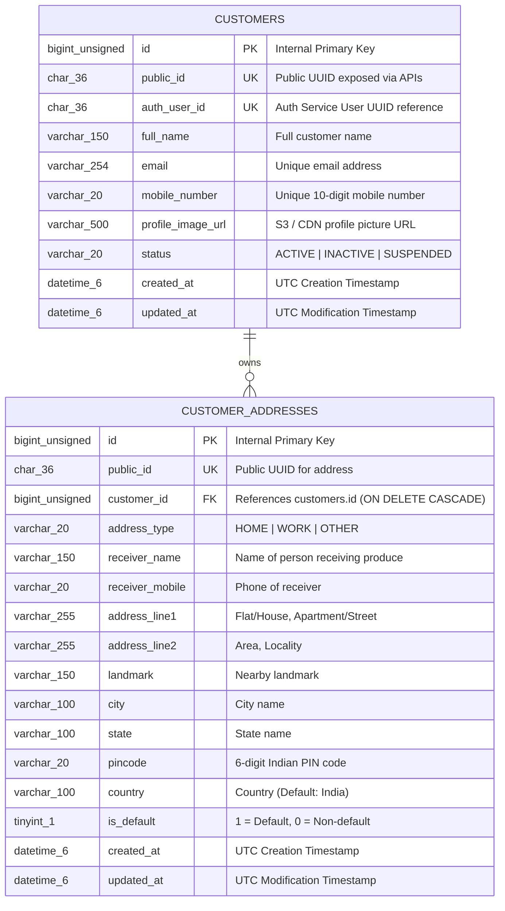

# RRV Green Basket — Customer Database Design

## 1. Database Overview

- **Database Name**: `customer_db`
- **RDBMS**: MySQL 8.0+ / 9.x InnoDB
- **Default Character Set**: `utf8mb4`
- **Collation**: `utf8mb4_0900_ai_ci`
- **Timezone**: UTC (`datetime(6)` precision)
- **Migration Tool**: Flyway (`V1__init_customer_schema.sql`)

Customer Service database is completely isolated from `auth_db`. There are **no cross-database foreign keys**. Inter-service relationships are established using UUID public identifiers (`auth_user_id` matching `auth_users.public_id`).

---

## 2. Entity-Relationship Diagram



---

## 3. Detailed Table Specifications

### 3.1 `customers` Table

| Column Name | Data Type | Nullable | Default | Constraints / Indexes | Description |
|---|---|---|---|---|---|
| `id` | `BIGINT UNSIGNED` | NO | `AUTO_INCREMENT` | `PRIMARY KEY` | Internal surrogate identifier |
| `public_id` | `CHAR(36)` | NO | None | `UNIQUE (uk_customers_public_id)` | Public UUID exposed to clients |
| `auth_user_id` | `CHAR(36)` | NO | None | `UNIQUE (uk_customers_auth_user_id)` | Auth User UUID linkage |
| `full_name` | `VARCHAR(150)` | NO | None | None | Full legal or display name |
| `email` | `VARCHAR(254)` | YES | `NULL` | `INDEX (idx_customers_email)` | Customer email address |
| `mobile_number` | `VARCHAR(20)` | NO | None | `UNIQUE (uk_customers_mobile)` | Unique normalized mobile number |
| `profile_image_url` | `VARCHAR(500)`| YES | `NULL` | None | URL to avatar image |
| `status` | `VARCHAR(20)` | NO | `'ACTIVE'` | `CHECK (status IN ('ACTIVE','INACTIVE','SUSPENDED'))`, `INDEX` | Account standing |
| `created_at` | `DATETIME(6)` | NO | `CURRENT_TIMESTAMP(6)` | None | Record creation timestamp |
| `updated_at` | `DATETIME(6)` | NO | `CURRENT_TIMESTAMP(6) ON UPDATE CURRENT_TIMESTAMP(6)` | None | Last update timestamp |

### 3.2 `customer_addresses` Table

| Column Name | Data Type | Nullable | Default | Constraints / Indexes | Description |
|---|---|---|---|---|---|
| `id` | `BIGINT UNSIGNED` | NO | `AUTO_INCREMENT` | `PRIMARY KEY` | Internal surrogate identifier |
| `public_id` | `CHAR(36)` | NO | None | `UNIQUE (uk_customer_addresses_public_id)` | Public UUID for address |
| `customer_id` | `BIGINT UNSIGNED` | NO | None | `FK -> customers(id) ON DELETE CASCADE`, `INDEX` | Owning customer foreign key |
| `address_type` | `VARCHAR(20)` | NO | `'HOME'` | `CHECK (address_type IN ('HOME','WORK','OTHER'))` | Destination type classification |
| `receiver_name` | `VARCHAR(150)` | NO | None | None | Contact name for delivery |
| `receiver_mobile` | `VARCHAR(20)` | NO | None | None | Mobile number for delivery driver |
| `address_line1` | `VARCHAR(255)` | NO | None | None | Primary street / apartment address |
| `address_line2` | `VARCHAR(255)` | YES | `NULL` | None | Secondary address details |
| `landmark` | `VARCHAR(150)` | YES | `NULL` | None | Landmark for delivery routing |
| `city` | `VARCHAR(100)` | NO | None | None | City (e.g., Bangalore, Hyderabad) |
| `state` | `VARCHAR(100)` | NO | None | None | State (e.g., Karnataka, Telangana) |
| `pincode` | `VARCHAR(20)` | NO | None | None | Postal PIN code |
| `country` | `VARCHAR(100)` | NO | `'India'` | None | Country |
| `is_default` | `TINYINT(1)` | NO | `0` | `INDEX (customer_id, is_default)` | Boolean flag for default address |
| `created_at` | `DATETIME(6)` | NO | `CURRENT_TIMESTAMP(6)` | None | Record creation timestamp |
| `updated_at` | `DATETIME(6)` | NO | `CURRENT_TIMESTAMP(6) ON UPDATE CURRENT_TIMESTAMP(6)` | None | Last update timestamp |

---

## 4. Flyway Migration Script

File: `customer-service/src/main/resources/db/migration/V1__init_customer_schema.sql`

```sql
CREATE TABLE IF NOT EXISTS `customers` (
  `id` bigint unsigned NOT NULL AUTO_INCREMENT,
  `public_id` char(36) NOT NULL,
  `auth_user_id` char(36) NOT NULL,
  `full_name` varchar(150) NOT NULL,
  `email` varchar(254) DEFAULT NULL,
  `mobile_number` varchar(20) NOT NULL,
  `profile_image_url` varchar(500) DEFAULT NULL,
  `status` varchar(20) NOT NULL DEFAULT 'ACTIVE',
  `created_at` datetime(6) NOT NULL DEFAULT CURRENT_TIMESTAMP(6),
  `updated_at` datetime(6) NOT NULL DEFAULT CURRENT_TIMESTAMP(6) ON UPDATE CURRENT_TIMESTAMP(6),
  PRIMARY KEY (`id`),
  UNIQUE KEY `uk_customers_public_id` (`public_id`),
  UNIQUE KEY `uk_customers_auth_user_id` (`auth_user_id`),
  UNIQUE KEY `uk_customers_mobile` (`mobile_number`),
  KEY `idx_customers_email` (`email`),
  KEY `idx_customers_status` (`status`),
  CONSTRAINT `chk_customers_status` CHECK ((`status` in ('ACTIVE','INACTIVE','SUSPENDED')))
) ENGINE=InnoDB DEFAULT CHARSET=utf8mb4 COLLATE=utf8mb4_0900_ai_ci;

CREATE TABLE IF NOT EXISTS `customer_addresses` (
  `id` bigint unsigned NOT NULL AUTO_INCREMENT,
  `public_id` char(36) NOT NULL,
  `customer_id` bigint unsigned NOT NULL,
  `address_type` varchar(20) NOT NULL DEFAULT 'HOME',
  `receiver_name` varchar(150) NOT NULL,
  `receiver_mobile` varchar(20) NOT NULL,
  `address_line1` varchar(255) NOT NULL,
  `address_line2` varchar(255) DEFAULT NULL,
  `landmark` varchar(150) DEFAULT NULL,
  `city` varchar(100) NOT NULL,
  `state` varchar(100) NOT NULL,
  `pincode` varchar(20) NOT NULL,
  `country` varchar(100) NOT NULL DEFAULT 'India',
  `is_default` tinyint(1) NOT NULL DEFAULT '0',
  `created_at` datetime(6) NOT NULL DEFAULT CURRENT_TIMESTAMP(6),
  `updated_at` datetime(6) NOT NULL DEFAULT CURRENT_TIMESTAMP(6) ON UPDATE CURRENT_TIMESTAMP(6),
  PRIMARY KEY (`id`),
  UNIQUE KEY `uk_customer_addresses_public_id` (`public_id`),
  KEY `idx_customer_addresses_customer_id` (`customer_id`),
  KEY `idx_customer_addresses_default` (`customer_id`, `is_default`),
  CONSTRAINT `fk_customer_addresses_customer` FOREIGN KEY (`customer_id`) REFERENCES `customers` (`id`) ON DELETE CASCADE,
  CONSTRAINT `chk_customer_address_type` CHECK ((`address_type` in ('HOME','WORK','OTHER')))
) ENGINE=InnoDB DEFAULT CHARSET=utf8mb4 COLLATE=utf8mb4_0900_ai_ci;
```
