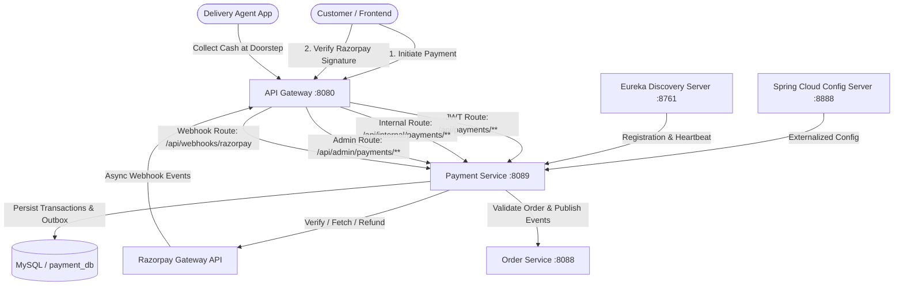
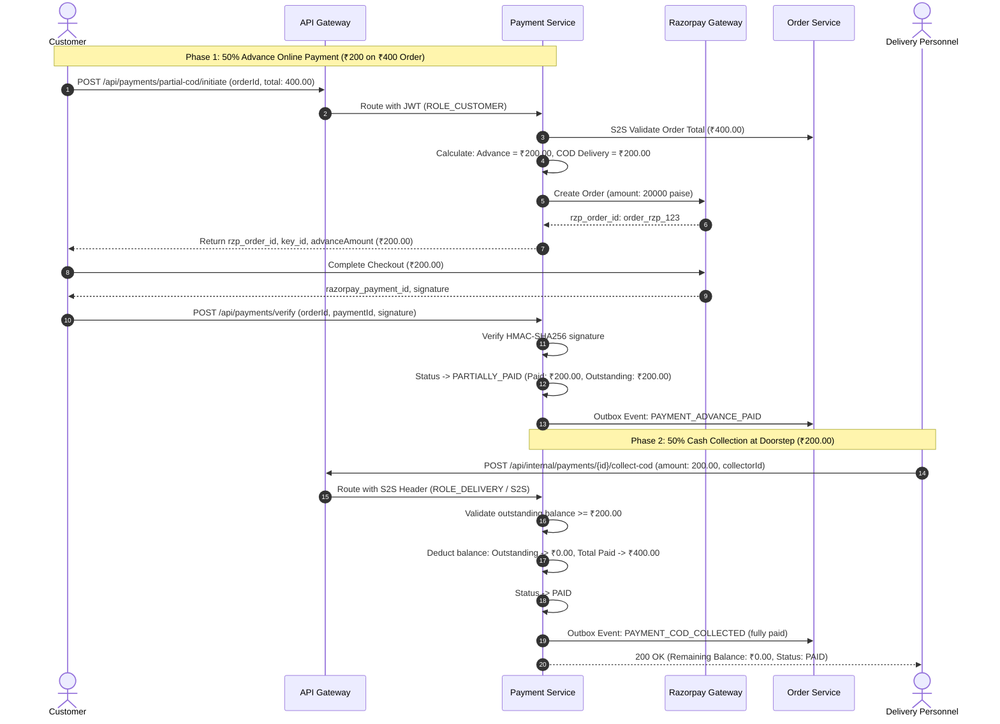

# RRV Green Basket - Payment Service

## 1. Overview

The **Payment Service** (`payment-service`) is a core microservice in the **RRV Green Basket** e-commerce platform. It provides production-grade payment lifecycle orchestration supporting:

1. **`ONLINE_FULL`**: 100% upfront digital payment via **Razorpay** Standard Checkout.
2. **`PARTIAL_ONLINE_COD`**: 50% online advance collected through **Razorpay** when placing an order, followed by 50% Cash on Delivery collected by authorized delivery personnel at the customer's doorstep.
3. **Delivery Cash Collection**: S2S / Delivery-personnel cash collection recording with idempotency, duplicate prevention, and balance updates.
4. **Authoritative Verification & Webhooks**: Server-side constant-time HMAC-SHA256 signature verification for Checkout and Webhooks, with idempotency and replay attack protection.
5. **Refunds**: Online advance full and partial refunds with balance tracking and idempotency.
6. **Transactional Outbox & Reconciliation**: Event publishing to Order Service with scheduled background outbox polling and periodic Razorpay status reconciliation.

---

## 2. Architecture & Service Interactions



### Partial COD Lifecycle Flow



---

## 3. Database Schema & Flyway Migrations

The database migration is managed via Flyway (`V1__init_payment_schema.sql`):

| Table Name | Purpose | Key Indexes |
|---|---|---|
| `payments` | Core payment record, method, total, advance, COD, paid, outstanding, and status | `order_id` (UNIQUE), `payment_public_id` (UNIQUE), `customer_id`, `status` |
| `payment_transactions` | Every gateway / cash transaction attempt, reference, payload, and status | `transaction_public_id` (UNIQUE), `payment_id`, `provider_payment_id` |
| `cod_collections` | Authorized doorstep cash collections by delivery agents | `collection_public_id` (UNIQUE), `payment_id`, `collector_id`, `receipt_number` |
| `payment_refunds` | Initiated refunds, gateway refund reference, reason, and status | `refund_public_id` (UNIQUE), `payment_id`, `provider_refund_id` |
| `payment_webhook_events` | Webhook inbox for deduplication, payload persistence, and processing status | `event_id` (UNIQUE), `payment_id`, `provider_order_id`, `status` |
| `payment_status_history` | Audit log of all status transitions with actor and reason | `payment_id`, `created_at` |
| `payment_idempotency_keys` | Replay protection for collection, payment, and refund endpoints | `idempotency_key` (UNIQUE), `endpoint` |
| `payment_event_outbox` | Transactional outbox for guaranteed downstream domain event delivery | `event_public_id` (UNIQUE), `status`, `created_at` |

---

## 4. Configuration & Environment Variables

### Application Configuration (`application.yml` / `payment-service-dev.yml`)

```yaml
server:
  port: 8089

spring:
  application:
    name: payment-service
  datasource:
    url: jdbc:mysql://${DB_HOST:localhost}:${DB_PORT:3306}/${DB_NAME:payment_db}?useSSL=false&serverTimezone=Asia/Kolkata&allowPublicKeyRetrieval=true
    username: ${DB_USER:root}
    password: ${DB_PASSWORD:root}
  jpa:
    hibernate:
      ddl-auto: validate
  flyway:
    enabled: true
    baseline-on-migrate: true

payment:
  partial-cod:
    enabled: true
    advance-percentage: 50
    delivery-collection-percentage: 50
    currency: INR
  razorpay:
    enabled: ${RAZORPAY_ENABLED:true}
    key-id: ${RAZORPAY_KEY_ID:rzp_test_placeholder}
    key-secret: ${RAZORPAY_KEY_SECRET:rzp_secret_placeholder}
    webhook-secret: ${RAZORPAY_WEBHOOK_SECRET:rzp_webhook_secret_placeholder}
    auto-capture: true
  security:
    jwt:
      secret: ${JWT_SECRET:404E635266556A586E3272357538782F413F4428472B4B6250645367566B5970}
    internal:
      secret: ${INTERNAL_SERVICE_SECRET:internal-secret-token-for-s2s-auth-rrv-green-basket}
```

### Environment Variables Template (`.env.example`)

```properties
RAZORPAY_KEY_ID=rzp_test_YourTestKeyIdHere
RAZORPAY_KEY_SECRET=YourTestKeySecretHere
RAZORPAY_WEBHOOK_SECRET=YourWebhookSecretHere
RAZORPAY_ENABLED=true
JWT_SECRET=404E635266556A586E3272357538782F413F4428472B4B6250645367566B5970
INTERNAL_SERVICE_SECRET=internal-secret-token-for-s2s-auth-rrv-green-basket
DB_HOST=localhost
DB_PORT=3306
DB_NAME=payment_db
DB_USER=root
DB_PASSWORD=root
```

---

## 5. Security & Authentication Model

1. **Customer Endpoints (`/api/payments/**`)**:
   - Authenticated via JWT bearer token in `Authorization: Bearer <token>` or `X-User-Id` / `X-User-Roles` injected by API Gateway.
   - Resource ownership verification ensures customers cannot view or modify another customer's payment records.
2. **Internal Endpoints (`/api/internal/payments/**`)**:
   - Authenticated via `X-Internal-Service: internal-secret-token-for-s2s-auth-rrv-green-basket` or S2S HMAC signature (`X-Service-Name`, `X-Timestamp`, `X-Signature`).
   - Requires role `ROLE_DELIVERY`, `ROLE_ADMIN`, or `ROLE_INTERNAL_SERVICE`.
3. **Admin Endpoints (`/api/admin/payments/**`)**:
   - Requires `ROLE_ADMIN` authority.
4. **Webhook Endpoint (`/api/webhooks/razorpay`)**:
   - Publicly accessible endpoint exempt from JWT filters.
   - Authoritative HMAC-SHA256 signature verified against raw HTTP payload using `X-Razorpay-Signature`.

---

## 6. End-to-End Testing Scenarios & cURL Commands

### Scenario A: Full Online Payment (`ONLINE_FULL` - ₹400.00)

#### 1. Initiate Full Online Payment
```bash
curl -X POST http://localhost:8080/api/payments/initiate \
  -H "Content-Type: application/json" \
  -H "Authorization: Bearer <CUSTOMER_JWT_TOKEN>" \
  -d '{
    "orderPublicId": "550e8400-e29b-41d4-a716-446655440001",
    "amount": 400.00,
    "paymentMethod": "ONLINE_FULL",
    "idempotencyKey": "order-400-initiate-1"
  }'
```
*Response:*
```json
{
  "success": true,
  "message": "Online payment initiated successfully",
  "data": {
    "paymentPublicId": "pay-uuid-400",
    "orderPublicId": "550e8400-e29b-41d4-a716-446655440001",
    "razorpayOrderId": "order_rzp_full_123",
    "razorpayKeyId": "rzp_test_placeholder",
    "amount": 400.00,
    "amountPaise": 40000,
    "currency": "INR",
    "paymentMethod": "ONLINE_FULL",
    "status": "INITIATED"
  }
}
```

#### 2. Verify Checkout Signature
```bash
curl -X POST http://localhost:8080/api/payments/verify \
  -H "Content-Type: application/json" \
  -H "Authorization: Bearer <CUSTOMER_JWT_TOKEN>" \
  -d '{
    "orderPublicId": "550e8400-e29b-41d4-a716-446655440001",
    "paymentPublicId": "pay-uuid-400",
    "razorpayOrderId": "order_rzp_full_123",
    "razorpayPaymentId": "pay_rzp_full_999",
    "razorpaySignature": "computed_hmac_sha256_hex_signature"
  }'
```
*Response:*
```json
{
  "success": true,
  "message": "Payment verified and recorded successfully",
  "data": {
    "paymentPublicId": "pay-uuid-400",
    "orderPublicId": "550e8400-e29b-41d4-a716-446655440001",
    "totalAmount": 400.00,
    "paidAmount": 400.00,
    "outstandingBalance": 0.00,
    "paymentMethod": "ONLINE_FULL",
    "status": "PAID"
  }
}
```

---

### Scenario B: 50% Advance Online + 50% Cash on Delivery (`PARTIAL_ONLINE_COD`)

#### 1. Initiate 50% Advance Payment
```bash
curl -X POST http://localhost:8080/api/payments/partial-cod/initiate \
  -H "Content-Type: application/json" \
  -H "Authorization: Bearer <CUSTOMER_JWT_TOKEN>" \
  -d '{
    "orderPublicId": "550e8400-e29b-41d4-a716-446655440002",
    "totalOrderAmount": 400.00,
    "idempotencyKey": "order-cod-initiate-2"
  }'
```
*Response:*
```json
{
  "success": true,
  "message": "Partial COD payment initiated successfully",
  "data": {
    "paymentPublicId": "pay-uuid-cod-50",
    "orderPublicId": "550e8400-e29b-41d4-a716-446655440002",
    "razorpayOrderId": "order_rzp_adv_456",
    "razorpayKeyId": "rzp_test_placeholder",
    "totalOrderAmount": 400.00,
    "advancePercentage": 50.00,
    "onlineAdvanceAmount": 200.00,
    "deliveryCollectionPercentage": 50.00,
    "deliveryAmount": 200.00,
    "amountPaise": 20000,
    "currency": "INR",
    "paymentMethod": "PARTIAL_ONLINE_COD",
    "status": "INITIATED"
  }
}
```

#### 2. Verify Advance Online Payment
```bash
curl -X POST http://localhost:8080/api/payments/verify \
  -H "Content-Type: application/json" \
  -H "Authorization: Bearer <CUSTOMER_JWT_TOKEN>" \
  -d '{
    "orderPublicId": "550e8400-e29b-41d4-a716-446655440002",
    "paymentPublicId": "pay-uuid-cod-50",
    "razorpayOrderId": "order_rzp_adv_456",
    "razorpayPaymentId": "pay_rzp_adv_789",
    "razorpaySignature": "computed_hmac_sha256_hex_signature"
  }'
```
*Response:*
```json
{
  "success": true,
  "message": "Payment verified and recorded successfully",
  "data": {
    "paymentPublicId": "pay-uuid-cod-50",
    "orderPublicId": "550e8400-e29b-41d4-a716-446655440002",
    "totalAmount": 400.00,
    "onlineAdvanceAmount": 200.00,
    "codDeliveryAmount": 200.00,
    "paidAmount": 200.00,
    "outstandingBalance": 200.00,
    "paymentMethod": "PARTIAL_ONLINE_COD",
    "status": "PARTIALLY_PAID"
  }
}
```

#### 3. Delivery Agent Collects Remaining ₹200.00 Cash at Doorstep
```bash
curl -X POST http://localhost:8080/api/internal/payments/pay-uuid-cod-50/collect-cod \
  -H "Content-Type: application/json" \
  -H "X-Internal-Service: internal-secret-token-for-s2s-auth-rrv-green-basket" \
  -H "X-User-Roles: ROLE_DELIVERY" \
  -d '{
    "orderPublicId": "550e8400-e29b-41d4-a716-446655440002",
    "amount": 200.00,
    "collectorId": "agent-ramesh-12",
    "collectorName": "Ramesh Kumar",
    "receiptNumber": "REC-COD-2026-001",
    "notes": "Collected cash at customer door",
    "idempotencyKey": "cod-collect-doorstep-001"
  }'
```
*Response:*
```json
{
  "success": true,
  "message": "COD cash collection recorded successfully",
  "data": {
    "collectionPublicId": "col-uuid-12345",
    "paymentPublicId": "pay-uuid-cod-50",
    "orderPublicId": "550e8400-e29b-41d4-a716-446655440002",
    "collectedAmount": 200.00,
    "totalPaidAmount": 400.00,
    "remainingOutstandingBalance": 0.00,
    "collectorId": "agent-ramesh-12",
    "receiptNumber": "REC-COD-2026-001",
    "paymentStatus": "PAID"
  }
}
```

---

### Scenario C: Razorpay Webhook Ingestion

```bash
curl -X POST http://localhost:8080/api/webhooks/razorpay \
  -H "Content-Type: application/json" \
  -H "X-Razorpay-Signature: <computed_webhook_hmac_hex>" \
  -d '{
    "entity": "event",
    "account_id": "acc_test_123",
    "event": "payment.captured",
    "contains": ["payment"],
    "payload": {
      "payment": {
        "entity": {
          "id": "pay_rzp_webhook_999",
          "order_id": "order_rzp_webhook_123",
          "amount": 20000,
          "currency": "INR",
          "status": "captured",
          "method": "upi"
        }
      }
    },
    "created_at": 1794278400
  }'
```
*Response:*
```json
{
  "status": "SUCCESS",
  "message": "Webhook processed successfully"
}
```

---

### Scenario D: Refund Processing (Admin)

```bash
curl -X POST http://localhost:8080/api/admin/payments/pay-uuid-cod-50/refund \
  -H "Content-Type: application/json" \
  -H "Authorization: Bearer <ADMIN_JWT_TOKEN>" \
  -d '{
    "amount": 100.00,
    "reason": "Damaged goods in delivery",
    "idempotencyKey": "refund-idemp-001"
  }'
```
*Response:*
```json
{
  "success": true,
  "message": "Refund processed successfully",
  "data": {
    "refundPublicId": "ref-uuid-001",
    "paymentPublicId": "pay-uuid-cod-50",
    "refundAmount": 100.00,
    "refundStatus": "COMPLETED",
    "providerRefundId": "rfnd_simulated_test_001",
    "newPaymentStatus": "PARTIALLY_REFUNDED"
  }
}
```

---

## 7. Troubleshooting & Error Codes

| Error Code | HTTP Status | Description | Action |
|---|---|---|---|
| `ORDER_NOT_FOUND` | 404 | Order ID could not be found or verified | Check Order Service communication |
| `AMOUNT_MISMATCH` | 400 | Request amount does not match trusted order total | Always trust server-side Order total |
| `INVALID_SIGNATURE` | 400 | Checkout or webhook HMAC-SHA256 signature mismatch | Verify `RAZORPAY_KEY_SECRET` / `RAZORPAY_WEBHOOK_SECRET` |
| `INVALID_PAYMENT_STATE` | 400 | Operation not allowed in current state (e.g. collecting COD on unpaid advance) | Ensure advance online payment is captured first |
| `COLLECTION_EXCEEDS_BALANCE` | 400 | COD cash collection amount is greater than remaining balance | Check outstanding balance before collecting |
| `IDEMPOTENCY_CONFLICT` | 409 | Identical idempotency key reused with different payload | Use fresh idempotency key for new requests |
| `REFUND_EXCEEDS_ONLINE_PAID` | 400 | Requested refund exceeds captured online advance payment | Refunds can only be issued up to total online paid amount |
| `ACCESS_DENIED` | 403 | Customer attempting to access another user's payment | Verify authenticated user credentials |
