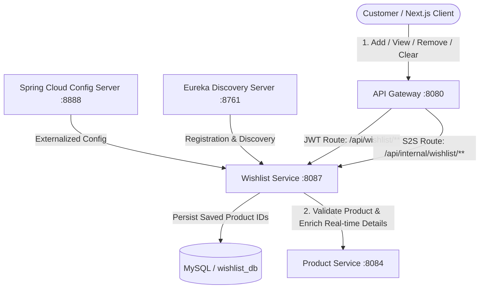
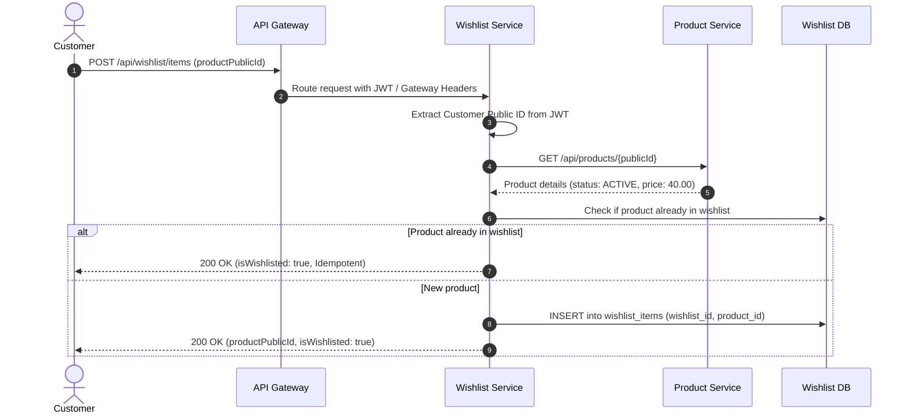

# RRV Green Basket - Wishlist Service

## 1. Overview

The **Wishlist Service** (`wishlist-service`) is a core microservice in the **RRV Green Basket** e-commerce platform. It provides persistent, authenticated wishlist management for customers purchasing next-day pre-order vegetables and fruits.

Key capabilities:
1. **Customer Saved Products**: Customers can save active products to their personal wishlists.
2. **Real-time Product Enrichment**: Dynamically queries the Product Service to return up-to-date product pricing, images, unit information, and real-time availability without storing stale prices.
3. **Idempotent Operations**: Handles duplicate additions and removals idempotently without data corruption.
4. **Resilience**: If Product Service is temporarily unavailable, existing saved wishlists are preserved without corruption and displayed with fallback placeholders.
5. **Customer Isolation & IDOR Protection**: Identity is strictly derived from verified JWT tokens or API Gateway assertion headers.
6. **Non-Invasive Domain Boundaries**: Wishlist operations never modify product prices, never reserve or deduct inventory, and never create orders or payments.

---

## 2. Architecture & Service Interactions



### Add to Wishlist Sequence Flow



---

## 3. Database Schema & Flyway Migrations

The database migration is managed via Flyway (`V1__init_wishlist_schema.sql`):

| Table Name | Purpose | Key Constraints & Indexes |
|---|---|---|
| `wishlists` | Customer wishlist parent entity | `wishlist_public_id` (UNIQUE), `customer_public_id` (UNIQUE), `idx_wishlists_customer` |
| `wishlist_items` | Individual saved products | `(wishlist_id, product_public_id)` (UNIQUE), `idx_wishlist_items_product`, FK to `wishlists.id` ON DELETE CASCADE |

---

## 4. Configuration & Environment Variables

### Application Configuration (`application.yml` / `wishlist-service-dev.yml`)

```yaml
server:
  port: 8087

spring:
  application:
    name: wishlist-service
  datasource:
    url: jdbc:mysql://${DB_HOST:localhost}:${DB_PORT:3306}/${DB_NAME:wishlist_db}?useSSL=false&serverTimezone=UTC&allowPublicKeyRetrieval=true
    username: ${MYSQL_USER:root}
    password: ${MYSQL_PASSWORD:root}
  jpa:
    hibernate:
      ddl-auto: validate
  flyway:
    enabled: true
    baseline-on-migrate: true

wishlist:
  validation:
    max-bulk-size: 50
  product-service:
    url: ${PRODUCT_SERVICE_URL:http://product-service}
    timeout-ms: 3000

app:
  jwt:
    secret: ${JWT_SECRET:404E635266556A586E3272357538782F413F4428472B4B6250645367566B5970}
  security:
    internal-service-secret: ${INTERNAL_SERVICE_SECRET:c8f7e2d1a5b49382716054321fedcba9876543210abcdef0123456789abcdef0}
```

### Environment Variables Template (`.env.example`)

```properties
SERVER_PORT=8087
WISHLIST_DB_URL=jdbc:mysql://localhost:3306/wishlist_db?useSSL=false&allowPublicKeyRetrieval=true&serverTimezone=UTC&createDatabaseIfNotExist=true
MYSQL_USER=root
MYSQL_PASSWORD=root
JWT_SECRET=404E635266556A586E3272357538782F413F4428472B4B6250645367566B5970
INTERNAL_SERVICE_SECRET=c8f7e2d1a5b49382716054321fedcba9876543210abcdef0123456789abcdef0
PRODUCT_SERVICE_URL=http://product-service
```

---

## 5. Security & Authentication

1. **Customer Endpoints (`/api/wishlist/**`)**:
   - Requires `ROLE_CUSTOMER`, `ROLE_USER`, or `ROLE_ADMIN`.
   - Customer public ID is strictly resolved from the authenticated JWT token subject or Gateway `X-User-Id` header.
   - Any attempt to provide customer ID via URL query or JSON request body is ignored, preventing Insecure Direct Object References (IDOR).
2. **Internal S2S Endpoints (`/api/internal/wishlist/**`)**:
   - Protected by `InternalServiceSecurityFilter`.
   - Requires `ROLE_INTERNAL_SERVICE` authenticated via `X-Internal-Service` shared secret or HMAC-SHA256 timestamped signatures.

---

## 6. End-to-End Testing Scenarios & cURL Commands

### 1. Add Product to Wishlist
```bash
curl -X POST http://localhost:8080/api/wishlist/items \
  -H "Content-Type: application/json" \
  -H "Authorization: Bearer <CUSTOMER_JWT_TOKEN>" \
  -d '{
    "productPublicId": "660e8400-e29b-41d4-a716-446655440001"
  }'
```
*Response (200 OK):*
```json
{
  "success": true,
  "message": "Product added to wishlist successfully",
  "data": {
    "productPublicId": "660e8400-e29b-41d4-a716-446655440001",
    "isWishlisted": true
  },
  "timestamp": "2026-11-10T06:45:00Z"
}
```

### 2. Add Duplicate Product (Idempotent Handling)
```bash
curl -X POST http://localhost:8080/api/wishlist/items \
  -H "Content-Type: application/json" \
  -H "Authorization: Bearer <CUSTOMER_JWT_TOKEN>" \
  -d '{
    "productPublicId": "660e8400-e29b-41d4-a716-446655440001"
  }'
```
*Response (200 OK - No duplicate created):*
```json
{
  "success": true,
  "message": "Product added to wishlist successfully",
  "data": {
    "productPublicId": "660e8400-e29b-41d4-a716-446655440001",
    "isWishlisted": true
  },
  "timestamp": "2026-11-10T06:45:02Z"
}
```

### 3. Get Complete Wishlist (Real-time Enriched Details)
```bash
curl -X GET http://localhost:8080/api/wishlist \
  -H "Authorization: Bearer <CUSTOMER_JWT_TOKEN>"
```
*Response (200 OK):*
```json
{
  "success": true,
  "message": "Wishlist retrieved successfully",
  "data": {
    "wishlistPublicId": "a1b2c3d4-e5f6-7890-abcd-ef1234567890",
    "customerPublicId": "550e8400-e29b-41d4-a716-446655440001",
    "totalItems": 1,
    "items": [
      {
        "productPublicId": "660e8400-e29b-41d4-a716-446655440001",
        "productName": "Fresh Organic Tomatoes",
        "productSlug": "fresh-organic-tomatoes",
        "productImage": "https://cdn.rrvgreenbasket.com/products/tomato.png",
        "price": 40.00,
        "unit": "KG",
        "availabilityStatus": "AVAILABLE",
        "stockStatus": "IN_STOCK",
        "isAvailable": true,
        "addedAt": "2026-11-10T06:45:00Z"
      }
    ]
  },
  "timestamp": "2026-11-10T06:45:10Z"
}
```

### 4. Get Wishlist Count (For Header Navigation Badges)
```bash
curl -X GET http://localhost:8080/api/wishlist/count \
  -H "Authorization: Bearer <CUSTOMER_JWT_TOKEN>"
```
*Response (200 OK):*
```json
{
  "success": true,
  "message": "Wishlist count retrieved successfully",
  "data": {
    "totalItems": 1
  },
  "timestamp": "2026-11-10T06:45:15Z"
}
```

### 5. Check Single Product Wishlist Status
```bash
curl -X GET http://localhost:8080/api/wishlist/items/660e8400-e29b-41d4-a716-446655440001/exists \
  -H "Authorization: Bearer <CUSTOMER_JWT_TOKEN>"
```
*Response (200 OK):*
```json
{
  "success": true,
  "message": "Wishlist status retrieved successfully",
  "data": {
    "productPublicId": "660e8400-e29b-41d4-a716-446655440001",
    "isWishlisted": true
  },
  "timestamp": "2026-11-10T06:45:20Z"
}
```

### 6. Bulk Wishlist Status Check
```bash
curl -X POST http://localhost:8080/api/wishlist/items/status \
  -H "Content-Type: application/json" \
  -H "Authorization: Bearer <CUSTOMER_JWT_TOKEN>" \
  -d '{
    "productPublicIds": [
      "660e8400-e29b-41d4-a716-446655440001",
      "660e8400-e29b-41d4-a716-446655440002"
    ]
  }'
```
*Response (200 OK):*
```json
{
  "success": true,
  "message": "Bulk wishlist status retrieved successfully",
  "data": {
    "customerPublicId": "550e8400-e29b-41d4-a716-446655440001",
    "statusMap": {
      "660e8400-e29b-41d4-a716-446655440001": true,
      "660e8400-e29b-41d4-a716-446655440002": false
    },
    "items": [
      {
        "productPublicId": "660e8400-e29b-41d4-a716-446655440001",
        "isWishlisted": true
      },
      {
        "productPublicId": "660e8400-e29b-41d4-a716-446655440002",
        "isWishlisted": false
      }
    ]
  },
  "timestamp": "2026-11-10T06:45:25Z"
}
```

### 7. Remove Product from Wishlist
```bash
curl -X DELETE http://localhost:8080/api/wishlist/items/660e8400-e29b-41d4-a716-446655440001 \
  -H "Authorization: Bearer <CUSTOMER_JWT_TOKEN>"
```
*Response (200 OK):*
```json
{
  "success": true,
  "message": "Product removed from wishlist successfully",
  "timestamp": "2026-11-10T06:45:30Z"
}
```

### 8. Clear Complete Wishlist
```bash
curl -X DELETE http://localhost:8080/api/wishlist \
  -H "Authorization: Bearer <CUSTOMER_JWT_TOKEN>"
```
*Response (200 OK):*
```json
{
  "success": true,
  "message": "Wishlist cleared successfully",
  "timestamp": "2026-11-10T06:45:35Z"
}
```

---

## 7. Error Codes and Troubleshooting

| Error Scenario | HTTP Status | Message | Resolution |
|---|---|---|---|
| Invalid Product UUID | `400 BAD REQUEST` | `Product public ID must be a valid 36-character UUID` | Ensure input is a valid RFC 4122 UUID |
| Inactive Product | `400 BAD REQUEST` | `Product is inactive or unavailable and cannot be wishlisted` | Only active products can be added to wishlists |
| Product Not Found | `404 NOT FOUND` | `Product not found with ID: {id}` | Verify product exists in product catalog |
| Product Not in Wishlist | `404 NOT FOUND` | `Product {id} not found in customer's wishlist` | Product was already removed or never added |
| Unauthenticated | `401 UNAUTHORIZED` | `Authentication required or token expired` | Provide valid customer Bearer JWT token |
| Access Denied | `403 FORBIDDEN` | `Access denied. Insufficient permissions` | Token does not carry `ROLE_CUSTOMER` |
| Product Service Down | `503 SERVICE UNAVAILABLE` | `Product Service is temporarily unavailable` | Check Product Service status; existing wishlists remain safe |
